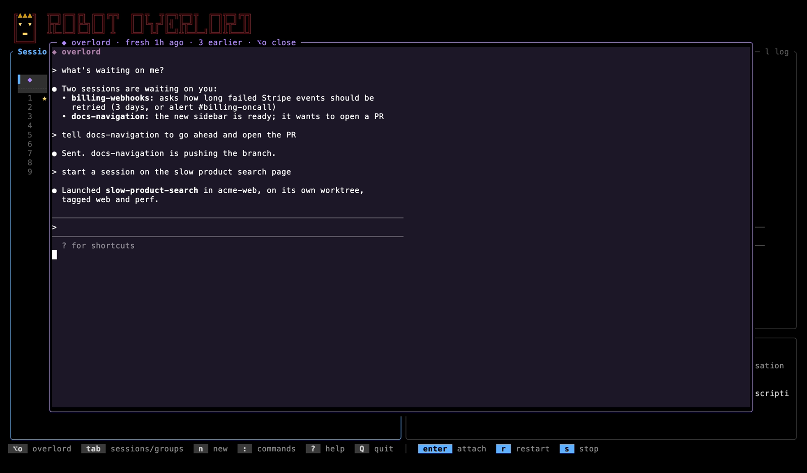
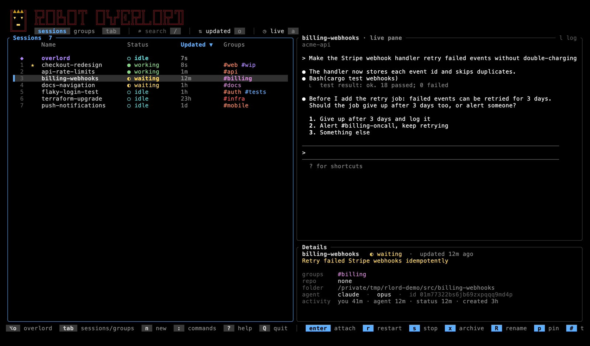
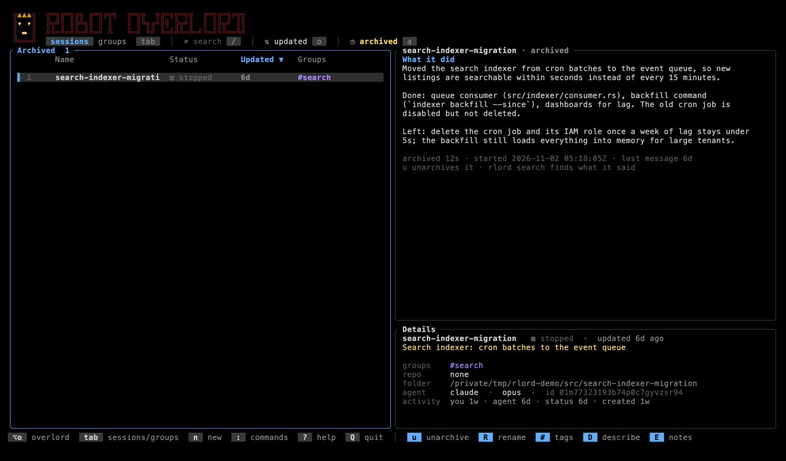

<p align="center"></p>

<div align="center">

# Robot Overlord

**Manage your AI coding agents with AI.**

`rlord` keeps every AI coding session you have (Claude Code, Codex,
OpenCode) running in tmux, in one list you can sort, search and organize,
and gives you an **overlord**: an AI session that drives rlord for you.

[Install](#install) · [How it works](#how-it-works) · [User guide](docs/guide.md) · [Contributing](CONTRIBUTING.md)



</div>

## Why

Starting AI coding sessions is easy. Keeping track of ten of them isn't:
which one was fixing the login bug, which is waiting on you, what did that
session from last week decide? rlord is built around a few ideas:

- **AI manages your AI sessions.** Organizing, tagging, describing and
  digging through dozens of agent sessions is tedious work, and it's
  exactly the kind of work AI is good at. So rlord is built around the
  overlord first: *"start a session on the flaky login tests"*, *"what's
  waiting on me?"*, *"tag everything about billing"*, *"we fixed this
  before, find it"*. The keys and the list are still there when you want
  them.
- **Plain code does the bookkeeping.** Tracking, sorting, searching and
  organizing are ordinary, fast code. The AI is spent where it earns its
  cost, not on every keypress.
- **Sessions are durable.** Every session can be stopped and resumed, even
  after a reboot, straight back into its conversation.
- **Context is first-class.** When a session last heard from you, when the
  agent last answered, what it's for, what it's waiting on: in the list,
  sortable, searchable.

## Features

- **The overlord.** One agent session (Claude Code, Codex or OpenCode:
  your pick) wired to rlord's tools, one keypress
  away from anywhere (Option-O / Alt-O). It finds and jumps to sessions,
  launches new ones, passes work to ones you already have, renames, tags
  and describes them, and answers questions about your fleet. It runs a
  strong model at medium effort and keeps its own work light, delegating
  anything heavy: bulk upkeep and research go to subagents, real work
  becomes a session of its own.
- **An overlord on each agent.** Out of usage on one? Switch the overlord
  to Codex or OpenCode with a click or a key, and back again later: each
  keeps its own conversation. Sessions stopped by a usage limit show when
  it resets, and can pick up by themselves then if you ask.
- **An overlord that doesn't bloat.** After sitting idle it starts a fresh
  conversation, and looks up what you talked about before only when you
  refer to it. The list shows when it last started fresh ("fresh 2h ago ·
  3 earlier") and keeps its earlier conversations, which you can read or
  continue.
- **One list for everything.** Live status (working, needs you, your
  turn), how much each session has used (turns, tokens or context %),
  sorting by your last message, the agent's or usage, groups by tag,
  favourites, search, and a live preview of the selected session.

  

- **Jump around without losing your place.** `enter` attaches; Option-D
  brings you back to the list from inside any session.
- **Archive with a memory.** Archived sessions keep a short summary of what
  they did, written for you when you archive them.

  

- **Search past work.** `rlord search` looks through every session's actual
  conversation, archived ones included; the overlord does it for you when
  you ask.
- **Bring your own setup.** rlord runs a private tmux server, but agent
  sessions can use your own tmux config (`rlord tmux import`). Every key can
  be rebound, and the key screen tells you whether a key will actually reach
  rlord.
- **Remote Control.** Pick a Claude Code session up from the Claude app on
  your phone while it keeps running at your desk.
- **macOS and Linux.**

## Install

```sh
curl -fsSL https://raw.githubusercontent.com/robot-lord/robot-overlord/main/scripts/get.sh | sh
```

This installs the latest release for your machine to `~/.local/bin/rlord`
(checksum-verified) and, if tmux is missing, offers to install it.

<details>
<summary>Other ways to install</summary>

| | |
|---|---|
| Homebrew (macOS, Linux) | `brew install robot-lord/tap/rlord` |
| Debian, Ubuntu | `sudo apt install ./rlord_<version>_<arch>.deb` from [releases](https://github.com/robot-lord/robot-overlord/releases) |
| Fedora, RHEL, Amazon Linux | `sudo dnf install ./rlord-<version>.<arch>.rpm` from releases |
| Cargo | `cargo install robot-overlord` |
| From source | `cargo build --release`, then put `target/release/rlord` on your PATH |

Prebuilt for Apple Silicon Macs and Linux (x86_64 and ARM; static, so any
distro).

</details>

**Requirements:** tmux 3.2+ and at least one agent:
[Claude Code](https://claude.com/claude-code),
[Codex CLI](https://github.com/openai/codex) or
[OpenCode](https://opencode.ai) v2. `rlord agents` shows which you have and
the install command for one you don't; rlord never installs them itself.

## Getting started

```sh
rlord install-hooks          # once: lets rlord see what your agents are doing
                             # (Claude Code, and Codex if it's installed;
                             # OpenCode needs none)
rlord                        # open the list
```

Then:

| | |
|---|---|
| **Option-O** (Alt-O) | open the overlord, and say what you want |
| `n` | start a new session: describe it, the overlord sets it up |
| `enter` | attach to the selected session |
| **Option-D** (Alt-D) | back to the list, from anywhere |
| `?` | every key; `:` for commands |

On a Mac, set your terminal to send Option as Alt/Meta (iTerm2: *Esc+*,
Ghostty: `macos-option-as-alt`, Terminal: *Use Option as Meta key*).

Already have Claude Code sessions? Ask the overlord to *"import my sessions
from the last week"*.

## How it works

```
                you
         ┌───────┴────────┐
         │                │ Option-O
         ▼                ▼
   ┌───────────┐    ┌──────────────────┐  delegates  ┌─────────────────┐
   │ the list  │    │     overlord     │ ──────────▶ │    subagents    │
   │   (TUI)   │    │  medium effort   │             │ (tidy, import,  │
   └─────┬─────┘    └────────┬─────────┘             │    research)    │
         │                   │ MCP tools             └─────────────────┘
         ▼                   ▼
   ┌──────────────────────────────────────────────────────────┐
   │      rlord daemon: sessions, status, search, summaries   │
   └─────────────────────────────┬────────────────────────────┘
                                 │ its own tmux server
          ┌──────────────┬───────┴──────┬──────────────┐
          ▼              ▼              ▼              ▼
       claude          codex        opencode          …
```

- **A daemon owns everything.** It keeps the session database, follows each
  agent's state (through Claude Code's and Codex's hooks, and OpenCode's
  own server), and serves the list, the CLI and the overlord over one local
  socket. It starts by itself the first time you
  run `rlord`.
- **Sessions are the ordinary agent CLIs**, each in a pane of rlord's own
  tmux server (`tmux -L rlord`); your own tmux is never touched. Stopping
  and resuming uses the agent's own resume (`claude --resume`, `codex
  resume`, OpenCode's `-s`).
- **The overlord is one agent session with rlord's tools** (an MCP
  server), floating over whatever you're looking at, on whichever agent
  you choose (Claude Code, Codex, OpenCode; one on each if you like, with
  one active at a time). It runs a strong model at medium
  effort: look-ups, small edits and short answers it does itself; anything
  that takes more goes to a subagent or a new session, so it stays quick
  and its own conversation stays small.
- **It can pass work to any session** (`send_to_session`), whatever agent
  runs either: rlord types it in once that session's turn is over. It does
  so without asking, since rlord expects to be run by its user on a machine
  they trust, or over a remote connection they trust. `[overlord]
  confirm_sends = true` makes each send ask.
- **The expensive part stays small.** Questions like "which sessions changed
  since I last looked?" or "what did we say about this earlier?" are
  answered by plain code; the overlord only spends tokens on what needs
  judgment.

The [user guide](docs/guide.md) covers each part in detail;
[architecture](docs/architecture.md) explains the design.

## Configuration

Everything is optional. `rlord config init` writes a commented
`~/.config/robot-overlord/config.toml`: layout, theme, keys, what the
Usage column shows, the default agent for new sessions, the overlord's
agent, model and effort, archive summaries, update channel. Standing instructions for the
overlord go in `~/.config/robot-overlord/overlord.md`.

## Updating

```sh
rlord update
```

Homebrew and distro packages update the usual way.

## Status

rlord is young and moves fast; it's used every day with Claude Code. Codex
and OpenCode (v2) sessions run beside Claude's (launch, resume, status,
usage, search, summaries; see [Codex sessions](docs/guide.md#codex-sessions)
and [OpenCode sessions](docs/guide.md#opencode-sessions) in the guide for
what doesn't work yet), and the overlord
runs on any of the three. Other agent CLIs are planned behind the same
adapter.

## Contributing

Issues and pull requests are welcome. See [CONTRIBUTING.md](CONTRIBUTING.md)
for building, testing and releasing.

## License

Licensed under either of [Apache License 2.0](LICENSE-APACHE) or
[MIT](LICENSE-MIT), at your option.
